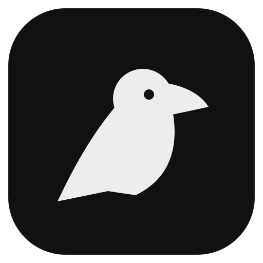
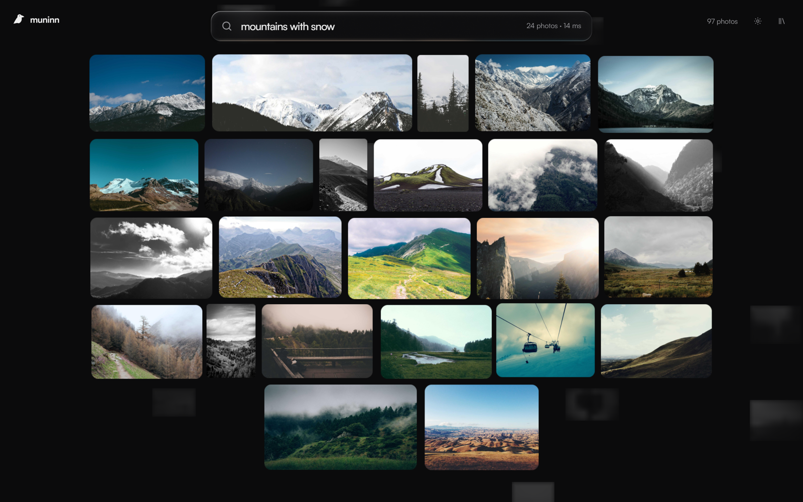
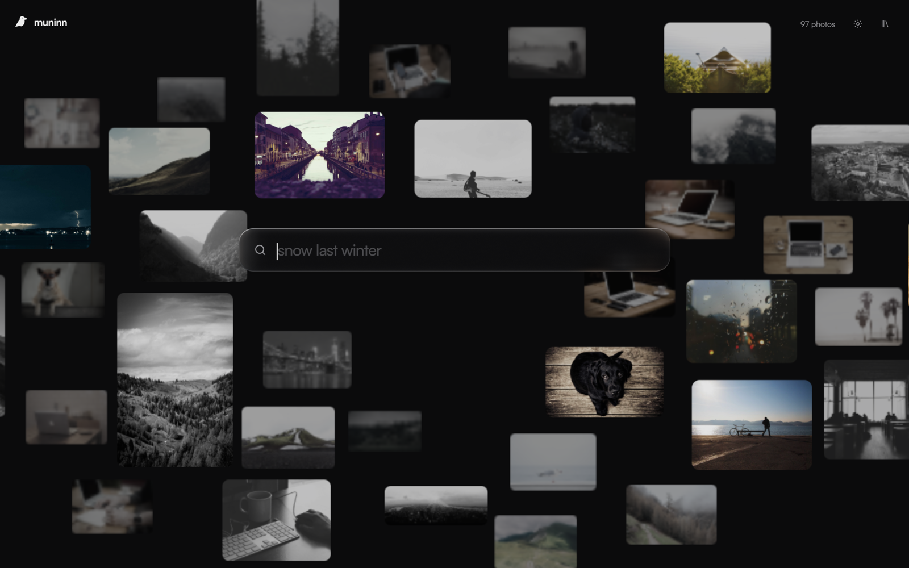
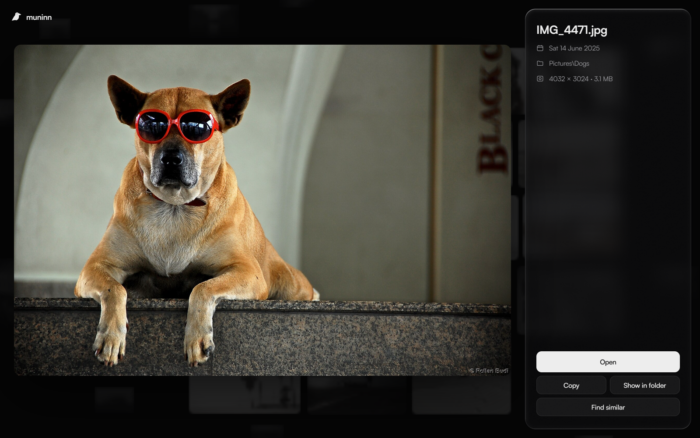

<p align="center">
  
</p>

<h1 align="center">Muninn</h1>

<p align="center">
  <b>Search your photos by describing them.</b><br>
  Type "dog on the beach", "receipts" or "snow last winter" and Muninn finds them. On your PC, offline, free :)
</p>

<p align="center">
  <a href="https://github.com/Kryzern/muninn/releases/latest"></a>
  <a href="https://github.com/Kryzern/muninn/releases"></a>
  
  
  <a href="LICENSE"></a>
</p>

<p align="center">
  <a href="#install">Install</a> ·
  <a href="#models">Models</a> ·
  <a href="#using-it">Using it</a> ·
  <a href="#settings">Settings</a> ·
  <a href="#building-from-source">Building</a>
</p>

<p align="center">
  
</p>

Your photos sit around you at different depths, drifting a little. Describe what you're looking for and the ones that match come forward into focus, sharp and in colour, while everything else falls back into the blur. The search bar is the same liquid glass as [Heimdall](https://github.com/Kryzern/Heimdall), drawn on your GPU.

Muninn is one of Odin's two ravens, the one whose name means *memory*. Every day he flies across the world and comes back with what he saw.

## What it does

- **Understands what's in a photo.** A CLIP model runs on your own PC and matches your words against what each photo shows, not its file name.
- **Understands dates.** "beach last summer", "snow last winter", "dog june 2024", "christmas", "yesterday". The date part becomes a filter (it shows as a chip under the bar), the rest goes to the model.
- **Reads text inside photos.** Receipts, screenshots, signs and menus, using the OCR built into Windows.
- **Find similar.** Open any photo and press <kbd>S</kbd> to see others like it.
- **Runs on your graphics card** through DirectML. Any DirectX 12 GPU works, integrated ones included. A search takes about 14 ms on an RTX 2070.
- **Reads every common format**: JPEG, PNG, WebP, HEIC, AVIF, TIFF and camera RAW (with the free Windows codecs).
- **Keeps up on its own.** New photos are searchable a few seconds after they're saved, and you can search while the first read is still going.
- **Leaves OneDrive alone.** Photos that are only in the cloud aren't downloaded to be read, unless you say so in Settings.
- **Skips the junk.** Icons, stickers and other tiny images aren't indexed.
- **Light when idle.** Nothing is drawn when nothing moves, so a Muninn window you're not touching uses no CPU or GPU.

## Install

1. Download `Muninn-0.4.0-x64-setup.exe` from the [latest release](https://github.com/Kryzern/muninn/releases/latest) and run it. It installs for your user only, no admin needed, and it's small because no model is bundled.
2. Open Muninn, click the library icon at the top right and download a model. The **Fast** one (about 300 MB) is a good start.
3. Muninn starts reading your Pictures, Desktop, Downloads and OneDrive Pictures folders. You can search straight away.

Uninstall from **Settings > Apps**. That removes Muninn's data too (`%LOCALAPPDATA%\Muninn`), downloaded models included.

<details>
<summary><b>Without the installer</b></summary>
<br>

The release also has `Muninn-0.4.0-x64.zip`. Unzip it anywhere and run `muninn.exe`. Everything it stores goes to `%LOCALAPPDATA%\Muninn`.

</details>

Requires Windows 10 or 11, x64.

## Models

Muninn doesn't ship with a model, so the download stays small and you pick the one that suits your PC. Each one downloads once from this repo's [`models-v1`](https://github.com/Kryzern/muninn/releases/tag/models-v1) release, is checked against its SHA-256, and then runs entirely offline.

| Model | Size | Good for |
|---|---|---|
| **Fast** · ViT-B/32 | 306 MB | Any PC, integrated graphics included. Good for most libraries. |
| **Balanced** · ViT-B/16 | 302 MB | Noticeably better at small details and busy scenes. Reading your photos takes about three times longer. |
| **Best** · ViT-L/14 | 858 MB | The most accurate. Wants a dedicated graphics card. |

All three are OpenCLIP models trained on DataComp-XL. Switching models reads your photos again with the new one, and each model keeps its own index, so switching back is instant. On a PC without a DirectX 12 GPU the download also includes the larger files the processor needs.

<p align="center">
  
</p>

## Using it

Just start typing. Matching photos come forward under the bar, best first.

| Key | Action |
|---|---|
| Type anywhere | Search |
| <kbd>↓</kbd> <kbd>→</kbd> <kbd>↑</kbd> <kbd>←</kbd> | Move through the results |
| <kbd>Enter</kbd> or click | Open the photo |
| <kbd>←</kbd> <kbd>→</kbd> in a photo | Previous / next result |
| <kbd>Enter</kbd> in a photo | Open it in your default app |
| <kbd>S</kbd> in a photo | Find similar photos |
| <kbd>Ctrl</kbd> + <kbd>C</kbd> in a photo | Copy the file, ready to paste into a chat or a folder |
| <kbd>Ctrl</kbd> + <kbd>,</kbd> | Settings |
| <kbd>Esc</kbd> | Close the photo, then clear the search |

<p align="center">
  
</p>

## Settings

Click the gear at the top right. Every option changes with one click:

- **Folders** to read: add or remove any folder, the defaults are Pictures, Desktop, Downloads and OneDrive Pictures
- **Read text in photos**: on or off
- **Photos only in OneDrive**: leave them in the cloud, or download and read them
- **Background photos**: lots, a few, or none
- **Glass** and **Animations**: on or off
- **Run the model on**: your graphics card or the processor
- **Open at sign-in**, so new photos are read in the background
- **Check for updates**: Muninn looks for a new version on GitHub a few times a day and only downloads one when you click it. That check is the only thing Muninn ever sends over the network.
- **Read every photo again**

## How it works

- **Drawing**: Direct3D 11 for the photos and the glass, Direct2D and DirectWrite for text, the same approach as Heimdall. Each photo is a GPU texture whose depth blur comes from its own mipmaps. The glass refracts the photos behind it at the rim, frosts them in the middle and catches a light that leans toward your pointer. Frames are only drawn while something moves, and are paced to your monitor's refresh rate.
- **Reading photos**: photos are decoded at reduced size through Windows Imaging Component while the GPU embeds the previous batch, about 75 twelve-megapixel photos per second on an RTX 2070. Photos that look like they hold text are read by Windows OCR afterwards, so plain photos never wait on it. The folders are watched, so a new photo is read a few seconds after it's saved.
- **Searching**: the date words in a query become filters, the rest is embedded by the model's text encoder and compared against every photo in parallel. Words found in a photo's text, or its file name, push it up the list.

Everything lives in `%LOCALAPPDATA%\Muninn`: settings, the index for each model, thumbnails and downloaded models.

### Command line

```
muninn index [folders...]   read folders (defaults to the ones in Settings)
muninn search <query>       print the top matches
muninn devices              list the GPUs Muninn can use
```

## Building from source

Requires Rust 1.85+ and [Inno Setup 6](https://jrsoftware.org/isinfo.php) for the installer.

```powershell
python tools/fetch_runtime.py              # ONNX Runtime + DirectML DLLs into runtime/
powershell -File packaging/build.ps1       # dist\Muninn, the zip and the installer
```

To export the models yourself (needs Python with `torch`, `open_clip_torch`, `onnx` and `onnxruntime`):

```powershell
python tools/export_onnx.py                          # Fast (ViT-B/32) into models/
python tools/export_onnx.py ViT-B-16 models-out/b16  # Balanced
python tools/export_onnx.py ViT-L-14 models-out/l14  # Best
python tools/package_models.py                       # dist\models + src\models.json
```

A source build finds the Fast model in `models/` on its own. To test model downloads against your own files, serve `dist\models` and set `MUNINN_MODELS_URL` to it.

## License

MIT. Satoshi is from Fontshare (ITF Free Font License). The models are OpenCLIP's DataComp-XL weights ([B/32](https://huggingface.co/laion/CLIP-ViT-B-32-DataComp.XL-s13B-b90K), [B/16](https://huggingface.co/laion/CLIP-ViT-B-16-DataComp.XL-s13B-b90K), [L/14](https://huggingface.co/laion/CLIP-ViT-L-14-DataComp.XL-s13B-b90K)), MIT licensed.

Photos in the screenshots are from Unsplash photographers via Lorem Picsum (Unsplash License), and "Dog chillin' with red sunglasses" by Rollan Budi, [CC BY-SA 2.0](https://commons.wikimedia.org/wiki/File%3ADog_chillin%27_with_red_sunglasses_%283545177630%29.jpg).
